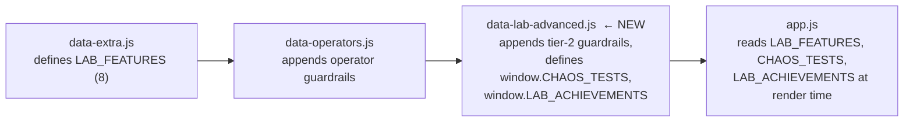
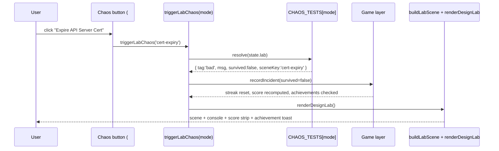
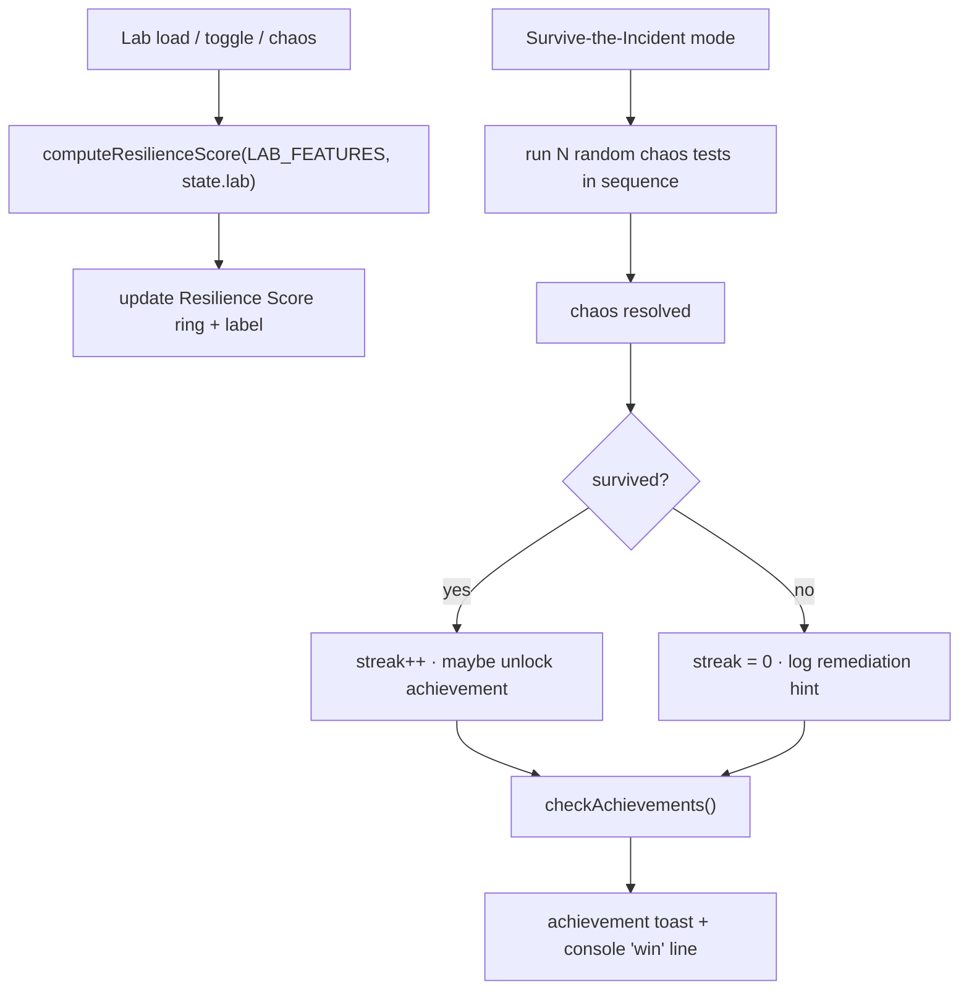

# Design Document

## Overview

This feature deepens the existing **Cluster Design Lab** — the interactive 2.5D Kubernetes simulator that is the third view of the "Kube to Scale" single-page app. The user's request: make it "bit more advanced more topic and bit more understanding and bit more playfull." Translated into four concrete axes:

1. **More advanced / more topics** — add a second tier of production guardrails (observability/backup/mesh/supply-chain/cost classes) and new chaos/attack scenarios (etcd disk-full, cert expiry, image-tag poisoning, noisy-neighbour, zone outage) beyond today's 5.
2. **More understanding** — attach a "why it matters" rationale, a remediation hint, and a one-line concept note to every guardrail and every chaos outcome, surfaced in the toggle tooltip and in richer console log lines, so the lab teaches *why* each control exists, not just that it flipped.
3. **More playful** — add a lightweight game layer: a composite **Resilience Score**, an **incident survival streak**, unlockable **achievements/badges**, and a timed **"Survive the Incident" challenge** mode, all rendered with the app's existing animation/console vocabulary.

The guiding principle, carried directly from the completed `operator-track-activation` spec, is **additive, backward-compatible change**. The existing lab must keep working byte-identically when none of the new content is enabled. The three gauges, the 8 base guardrails, the 5 base chaos tests, the SVG scene, and `state.lab` persistence are all preserved. New capability is layered on through: (a) an extended but backward-compatible `LAB_FEATURES` schema, (b) a new data-driven `CHAOS_TESTS` registry that supersedes the hardcoded `if/else` chain without removing its behavior, (c) a new game-state slice, and (d) a small set of new render helpers. No existing data file is rewritten; the base content keeps its current values and gauge contributions.

This design is grounded in the verified current code. File and line references point at the real implementation read during design.

### Verified facts that shape the design

- **No build/module system.** Every `data-*.js` file executes top-to-bottom in a shared global scope and mutates globals (`LESSONS`, `MODULES`, `LAB_FEATURES`, …). `app.js` holds all logic. `index.html` loads scripts in a fixed order ending in `app.js`. (Confirmed against the operator spec and the load pattern.)
- **`LAB_FEATURES`** is defined in `data-extra.js:680` as an array of `{ key, name, sub, sec, rel, plat }`. There are 8 base entries: `haEtcd, psa, netpol, cel, rbac, karpenter, gitops, falco` (data-extra.js:682–689).
- **Operator guardrails already append** to `LAB_FEATURES` via an IIFE at the end of `data-operators.js:1430`, mapping `OP_LAB_GUARDRAILS` (`api/rec/cln/ha`) into `sec/rel/plat`, with a **double-merge guard** (`if (LAB_FEATURES.some(f => f.key === g.key)) return;`, data-operators.js:1447). This is the established additive-extension pattern to follow.
- **Three gauges** `SECURITY/RELIABILITY/PLATFORM MATURITY` are computed in `renderDesignLab()` by a simple additive loop over `LAB_FEATURES` summing `sec/rel/plat` for enabled keys (app.js:1144–1146), then written as width-% by `setGauge` (app.js:1147–1156). No cap at 100.
- **Five chaos tests** are a hardcoded `if/else` chain in `triggerLabChaos(mode)` (app.js:1018–1045): `normal, kill-cp, root-pod, lateral-scan, traffic-spike, manual-drift`. Each reads `state.lab` (`L`) and logs an `ok`/`bad`/`info` line. The chaos buttons are hardcoded in `index.html` (`#labChaosBtns`, index.html ~324–330) with `data-chaos` attributes.
- **`buildLabScene()`** (app.js:1047–1131) builds an SVG scene via helpers `Z/N/E` and returns `{ zones, nodes, edges, trace, statusTxt, statusCol }`. It is **hardcoded** to the 8 base keys and the 5 chaos modes. `renderDesignLab()` calls `renderIsoScene('labSvg', scene, false)` then paints the trace dock and status chip (app.js:1158–1166).
- **Scene helper signatures** (verified in `data-lessons.js:5–8`):
  - `Z(x, y, w, h, label, color = '#6E685E') → { x, y, w, h, label, color }`
  - `N(id, x, y, shape, col, label, sub, badge = null, tip = '', offline = false) → { id, x, y, shape, col, label, sub, badge, tip, offline }`
  - `E(from, to, kind = 'req', opts = {}) → { from, to, kind, ...opts }`
- **Console** `addLabLog(tag, text)` unshifts `{ ts, tag, text }` into `state.labLogs`, caps the list at 18, and re-renders `#labConsole` with `.log-tag.ok/.bad/.info` styling (app.js:979–993, styles.css:609–611). Only three tag classes exist in CSS today.
- **State** (app.js, `state` object): `lab` is a toggle map seeded with `haEtcd:true, rbac:true` and the rest `false` (app.js ~50–53); `labChaos: 'normal'`; `labLogs: []`. `saveState()` persists `lab` (app.js:78); `loadState()` merges `raw.lab` over defaults (`state.lab = { ...state.lab, ...raw.lab }`, app.js:94). Only `lab` is persisted — `labChaos` and `labLogs` are session-only. The localStorage key is `kts_adv_state_v1` (app.js:85).
- **Preset / export.** `labPreset('hardened'|'bare')` sets every `LAB_FEATURES[key]` on/off (app.js:1003). `exportLabSummary()` emits a markdown checklist over `LAB_FEATURES` and copies via `copyString` (app.js:1011–1015). Both iterate whatever is in `LAB_FEATURES`, so appended guardrails are handled automatically.
- **Styling.** Lab classes exist: `.lab-grid`, `.lab-panel`, `.toggle-item(.on)`, `.switch-pill`, `.gauge-card/.gauge-bar`, `.chaos-row/.chaos-btn(.active-chaos)`, `.console-box/.log-line/.log-tag` (styles.css:559–611). The responsive collapse of `.lab-grid` to one column lives at styles.css:680.

---

## Architecture

### System context: where the enhancement sits

```mermaid
flowchart TD
  subgraph DATA["Data layer (global scope, load-ordered scripts)"]
    EX["data-extra.js<br/>LAB_FEATURES base 8"]
    OPS["data-operators.js<br/>appends 8 operator guardrails (existing)"]
    NEWD["data-lab-advanced.js  ← NEW script<br/>appends tier-2 guardrails,<br/>defines CHAOS_TESTS + ACHIEVEMENTS"]
  end
  subgraph LOGIC["app.js (Design Lab view)"]
    TOG["toggleLabFeature / labPreset"]
    GAUGE["renderDesignLab: 3 additive gauges"]
    CHAOS["triggerLabChaos → registry dispatch (NEW)"]
    GAME["game layer: score, streak, achievements (NEW)"]
    SCENE["buildLabScene → SVG (extended, NEW zones)"]
  end
  subgraph UI["index.html #view-lab + styles.css"]
    TOGUI["#labToggles (grouped, NEW tiers)"]
    CHAOSUI["#labChaosBtns (data-driven, NEW)"]
    SCOREUI["score / streak / achievement strip (NEW)"]
    SVGUI["#labSvg scene + console + trace dock"]
  end
  EX --> OPS --> NEWD --> LOGIC
  TOG --> GAUGE --> SCENE --> SVGUI
  CHAOS --> GAME --> GAUGE
  TOGUI --> TOG
  CHAOSUI --> CHAOS
  GAME --> SCOREUI
```



The new data file `data-lab-advanced.js` is a **consumer-and-extender** of existing globals, exactly like `data-operators.js`. It runs after `data-extra.js` (and after `data-operators.js`, which also mutates `LAB_FEATURES`) and before `app.js`, so by the time the lab renders, `LAB_FEATURES` already contains base + operator + tier-2 guardrails.

### Load order and registration



`data-lab-advanced.js` must be loaded **after `data-extra.js` and `data-operators.js`** (both mutate `LAB_FEATURES`) and **before `app.js`**. The existing operator script is already placed just before `app.js`; the new tag goes immediately after it. Each new guardrail uses the same double-merge guard the operator script uses, so a double-load or reorder cannot throw or duplicate entries.

### Chaos dispatch: from hardcoded chain to data-driven registry

Today `triggerLabChaos` is a fixed `if/else` over 5 modes. The design replaces the body with a **registry lookup** while preserving every existing outcome. Each chaos test becomes a `CHAOS_TESTS` entry whose `resolve(L)` returns the log tag + message + scoring outcome, and whose `scene` hints feed `buildLabScene`. The 5 base tests are ported into the registry verbatim (same guardrail checks, same strings) so behavior is identical; the new tests are added as more registry entries.



### Game loop (playfulness) data-flow



The game layer is **derived and session-scoped** except for unlocked achievements, which persist. It never changes how gauges are computed; it reads the same `state.lab` and `LAB_FEATURES` the gauges use.

---

## Components and Interfaces

All changes are confined to five files, four of them additive-only. `app.js` is edited (the lab functions live there); the edits extend behavior and keep every existing branch reachable.

### 1. `data-lab-advanced.js` (NEW) — tier-2 guardrails, chaos registry, achievements

**Purpose:** own all new lab *content* as data, so `app.js` logic stays generic. Mirrors the `data-operators.js` append pattern.

**Responsibilities:**
- Append tier-2 guardrails to `LAB_FEATURES` using the extended-but-compatible schema (new optional fields; `sec/rel/plat` still present).
- Define `window.CHAOS_TESTS` — the ordered registry of chaos tests (base 5 ported + new ones).
- Define `window.LAB_ACHIEVEMENTS` — the achievement catalog.
- Guard every mutation so a double-load is a no-op (same guard style as data-operators.js:1447).

**Interface (globals it publishes):**
```js
// Appended onto the existing LAB_FEATURES array (schema extended below).
// window.CHAOS_TESTS : ChaosTest[]   (see Data Models)
// window.LAB_ACHIEVEMENTS : Achievement[]
```

### 2. `app.js` — Design Lab view logic (EDITED, additive)

**Purpose:** consume the new data and render the new UI, without regressing existing behavior.

New / changed functions (signatures in Low-Level Design):
- `toggleLabFeature(key)` — unchanged behavior; after render, calls the new `afterLabStateChange()` so score/achievements recompute. Enriched log line uses the guardrail's `why` field when present.
- `triggerLabChaos(mode)` — **rewritten** to dispatch through `CHAOS_TESTS`. For the 5 base modes the ported registry entries reproduce today's exact tag + message. Records the incident into the game layer, then renders.
- `computeResilienceScore()` — NEW. Returns `{ score, band, sec, rel, plat }` from the same additive sums the gauges use (score = weighted blend of the three, clamped 0–100).
- `recordIncident(test, survived)` — NEW. Updates streak, best streak, incidents survived/faced; calls `checkAchievements`.
- `checkAchievements()` — NEW. Evaluates `LAB_ACHIEVEMENTS` predicates against current lab + game state; unlocks and toasts newly earned ones; persists.
- `startIncidentChallenge()` / `stepIncidentChallenge()` — NEW. "Survive the Incident" mode: queue a shuffled subset of chaos tests, run one on each advance, track survival.
- `renderLabScore()`, `renderLabAchievements()`, `showLabToast(text, tone)` — NEW render helpers for the game strip.
- `buildLabScene()` — **extended**: reads `CHAOS_TESTS[mode].scene` hints to decide node/edge styling for the new chaos modes, and adds optional zones/nodes for tier-2 guardrails that have a `scene` contribution (e.g. a "BACKUP / DR" vault node when `velero` is on). Existing 8-key / 5-mode rendering is unchanged.
- `renderDesignLab()` — **extended**: renders grouped toggles (tier headings), data-driven chaos buttons, the score/streak/achievement strip, plus the existing gauges/scene/console. Existing gauge loop unchanged.
- `afterLabStateChange()` — NEW private helper the three mutators call to recompute score, persist, and repaint the game strip.

### 3. `index.html` — view markup (EDITED, additive)

- Add a **load tag** `<script src="data-lab-advanced.js?v=1"></script>` immediately after the `data-operators.js` tag and before `app.js`. Bump `app.js?v=N → N+1` and `styles.css?v=N → N+1` for cache invalidation (same convention the operator spec used).
- `#labChaosBtns` becomes **render-target only**: remove the 5 hardcoded buttons and let `renderDesignLab()` populate it from `CHAOS_TESTS` (the base 5 are in the registry, so the same 5 buttons render). The "Clear Incident" button and the "Survive the Incident" launcher are static controls in the panel header.
- Add a **score/streak/achievement strip** container (`#labScoreStrip`, `#labAchievements`) in the right column, above or beside the gauges row. Add a **tier-grouped** wrapper intent for `#labToggles` (headings injected by render; the container id stays `labToggles`).
- Add a **challenge control** button (`onclick="startIncidentChallenge()"`) in the chaos panel header next to "Clear Incident".

### 4. `styles.css` — new visual classes (EDITED, additive)

New rules only; no existing rule is altered:
- `.lab-tier-head` — small uppercase mono heading separating guardrail tiers in the toggle list.
- `.score-ring` / `.score-ring-val` / `.score-band-*` — the Resilience Score ring/label (reuse gauge color thresholds: ≥75 green, ≥40 amber, else coral).
- `.streak-chip`, `.achv-row`, `.achv-badge(.locked)` — streak counter and achievement badges.
- `.lab-toast(.win/.bad)` — transient toast for achievement unlocks and incident outcomes.
- Two new console tag classes `.log-tag.win` and `.log-tag.warn` (today only `ok/bad/info` exist; new chaos/achievement lines use `win` for unlocks and `warn` for degraded-but-not-breached outcomes).
- Responsive: ensure the new strip collapses with `.lab-grid` at the existing `680px`/narrow breakpoints.

### 5. No other files change

`data-extra.js` and `data-operators.js` keep their guardrail definitions unchanged; the base and operator guardrails retain their exact `sec/rel/plat` values, which is the backward-compatibility anchor.

---

## Data Models

### Extended `LAB_FEATURES` entry (backward compatible)

The existing shape is `{ key, name, sub, sec, rel, plat }`. The design **adds optional fields**; existing entries are untouched and the new fields are ignored by the current gauge loop (which only reads `sec/rel/plat`).

```js
/**
 * @typedef {Object} LabFeature
 * @property {string} key      Unique id (collision-checked on append)
 * @property {string} name     Toggle title
 * @property {string} sub      One-line subtitle (existing)
 * @property {number} sec      Security gauge contribution (existing)
 * @property {number} rel      Reliability gauge contribution (existing)
 * @property {number} plat     Platform Maturity contribution (existing)
 * // --- NEW optional fields (absent on base/operator entries) ---
 * @property {string} [tier]   'core' | 'advanced'  (grouping; base+operator default to 'core')
 * @property {string} [why]    One-sentence rationale shown in tooltip + enriched log
 * @property {string} [concept] Short concept tag, e.g. 'RPO/RTO', 'supply chain'
 * @property {string} [sceneKey] Optional hint letting buildLabScene add a node/zone when enabled
 */
```

Tier-2 guardrails (new content; illustrative set — exact values finalized in requirements/implementation, keeping the additive gauge style where a full advanced stack stays bounded):

| key | name | tier | sec | rel | plat | concept |
|---|---|---|---|---|---|---|
| `velero` | Velero Backup + DR Restore | advanced | 5 | 20 | 15 | RPO/RTO |
| `mtls` | Service Mesh mTLS (Istio/Linkerd) | advanced | 20 | 5 | 15 | zero-trust transit |
| `cosign` | Cosign Image Signature Verify | advanced | 20 | 0 | 15 | supply chain |
| `pdbQuota` | PodDisruptionBudgets + ResourceQuota | advanced | 5 | 20 | 10 | graceful disruption |
| `otel` | OpenTelemetry + SLO Alerting | advanced | 5 | 15 | 20 | observability |
| `costGuard` | Cost Guardrails + Spot Rebalance | advanced | 0 | 10 | 15 | FinOps |

These are added only when `data-lab-advanced.js` loads, default **off** in `state.lab`, and therefore contribute 0 until toggled — the no-regression anchor (same reasoning as the operator spec's Req 9.4).

### `ChaosTest` (new registry entry)

```js
/**
 * @typedef {Object} ChaosTest
 * @property {string} mode        Registry key, matches data-chaos attribute, e.g. 'cert-expiry'
 * @property {string} label       Button text incl. emoji, e.g. '🔏 Expire API Server Cert'
 * @property {string} [tier]      'core' (base 5) | 'advanced' (new)
 * @property {(L: Object) => ChaosOutcome} resolve
 *   Pure function of the toggle map; returns outcome. MUST NOT mutate state.
 * @property {Object} [scene]     Hints for buildLabScene (status text, banner, which node turns coral/green)
 */

/**
 * @typedef {Object} ChaosOutcome
 * @property {('ok'|'bad'|'warn'|'info')} tag   Console tag / severity
 * @property {string} msg          Primary console line (what happened)
 * @property {boolean} survived    true if guardrails neutralized the incident (drives streak)
 * @property {string} [why]        "Why it matters" teaching line (second console line)
 * @property {string} [fix]        Remediation hint naming the guardrail(s) to enable
 */
```

**Base-5 port (behavior-preserving).** Each existing branch becomes a `resolve(L)`:
- `kill-cp` → `survived = !!L.haEtcd`; messages verbatim from app.js:1023–1025.
- `root-pod` → `survived = !!(L.psa || L.cel)`; messages from app.js:1027–1029.
- `lateral-scan` → `L.netpol` ⇒ ok/survived; else `L.falco` ⇒ info/not-survived (detected only); else bad; messages from app.js:1031–1033.
- `traffic-spike` → `survived = !!L.karpenter`; messages from app.js:1035–1037.
- `manual-drift` → `survived = !!L.gitops`; the drift-not-healed case keeps tag `bad` as today, but is classified as a non-breach (`survived=false`); messages from app.js:1039–1041.
- `normal` stays a special clear path (not a scored incident).

**New advanced chaos tests (more topics):**

| mode | label | neutralized by | survived when |
|---|---|---|---|
| `etcd-disk-full` | 💽 etcd Disk 100% Full | `velero` (restore) + `haEtcd` | `haEtcd && velero` |
| `cert-expiry` | 🔏 Expire API Server Cert | `haEtcd` (rotation on HA CP) | `haEtcd` |
| `image-poison` | 🧪 Pull Unsigned :latest Image | `cosign` or `cel` | `cosign || cel` |
| `noisy-neighbour` | 🔊 Noisy-Neighbour CPU Steal | `pdbQuota` (quota caps) + `karpenter` | `pdbQuota` |
| `zone-outage` | 🌐 Lose an Availability Zone | `haEtcd` + `pdbQuota` | `haEtcd && pdbQuota` |
| `mesh-mitm` | 🕵 In-Cluster MITM Sniff | `mtls` (or `netpol`) | `mtls` |

Each carries `why`/`fix` teaching lines so an unprotected outcome explains the missing control.

### `Achievement`

```js
/**
 * @typedef {Object} Achievement
 * @property {string} id          Stable id (persisted when unlocked)
 * @property {string} name        Display name, e.g. 'Quorum Keeper'
 * @property {string} icon        Emoji / glyph
 * @property {string} desc        How to earn it
 * @property {(ctx: AchvContext) => boolean} test   Predicate over lab + game state
 */

/**
 * @typedef {Object} AchvContext
 * @property {Object} lab           state.lab toggle map
 * @property {LabFeature[]} features LAB_FEATURES
 * @property {LabGame} game         state.labGame
 * @property {{score,band}} score   computeResilienceScore() result
 */
```

Illustrative catalog: `fullStack` (all guardrails on), `hardenedSec` (Security ≥ 100), `survivor5` (streak ≥ 5), `unbreakable` (survive every advanced chaos in one challenge run), `firstBlood` (survive first incident), `supplyChain` (`cosign` + `cel` on).

### New state slice `state.labGame`

```js
state.labGame = {
  streak: 0,            // current consecutive survived incidents (session)
  bestStreak: 0,        // best streak (persisted)
  survived: 0,          // total incidents survived (persisted)
  faced: 0,             // total incidents faced (persisted)
  unlocked: [],         // Achievement.id[] earned (persisted)
  challenge: null       // null | { queue: string[], idx, survivedCount, total } (session)
};
```

### Persistence delta (`saveState`/`loadState`)

`saveState` currently serializes `lab` (app.js:78). Add a **persisted subset** of `labGame`:
```js
// in saveState payload:
labGame: {
  bestStreak: state.labGame.bestStreak,
  survived:   state.labGame.survived,
  faced:      state.labGame.faced,
  unlocked:   [...state.labGame.unlocked]
}
```
`loadState` merges it back defensively (`state.labGame = { ...state.labGame, ...(raw.labGame||{}) }`, resetting session-only fields `streak/challenge` to defaults). Session-only fields (`streak`, `challenge`) are **not** persisted, matching how `labChaos`/`labLogs` are session-only today. The localStorage key stays `kts_adv_state_v1`; this is an additive field on the same payload, so old saved state loads without error (missing `labGame` → defaults).

---

## Low-Level Design

JavaScript (vanilla, ES2015+, no modules) — matching the codebase. All snippets are concrete and drop into `app.js` / `data-lab-advanced.js`.

### `data-lab-advanced.js` — append + registries (with double-load guard)

```js
/* =========================================================================
   DESIGN LAB — ADVANCED CONTENT (additive; mirrors data-operators.js pattern)
   ========================================================================= */
(function () {
  if (typeof LAB_FEATURES === 'undefined' || !Array.isArray(LAB_FEATURES)) return;

  const TIER2 = [
    { key: 'velero',   name: 'Velero Backup + DR Restore',        sub: 'Scheduled snapshots · tested restore',
      sec: 5,  rel: 20, plat: 15, tier: 'advanced', concept: 'RPO/RTO',
      why: 'Without tested backups, etcd corruption or a bad apply is unrecoverable.',
      sceneKey: 'backup' },
    { key: 'mtls',     name: 'Service Mesh mTLS',                 sub: 'Encrypted + authenticated pod-to-pod',
      sec: 20, rel: 5,  plat: 15, tier: 'advanced', concept: 'zero-trust transit',
      why: 'Flat in-cluster traffic lets a foothold sniff or spoof service calls.' },
    { key: 'cosign',   name: 'Cosign Image Signature Verify',     sub: 'Rejects unsigned / untrusted images',
      sec: 20, rel: 0,  plat: 15, tier: 'advanced', concept: 'supply chain',
      why: 'Unsigned images let a poisoned registry run attacker code as you.' },
    { key: 'pdbQuota', name: 'PodDisruptionBudgets + Quota',      sub: 'Graceful drains · bounded blast radius',
      sec: 5,  rel: 20, plat: 10, tier: 'advanced', concept: 'graceful disruption',
      why: 'No PDB means a node drain can take all replicas down at once.' },
    { key: 'otel',     name: 'OpenTelemetry + SLO Alerting',      sub: 'Traces, metrics, burn-rate alerts',
      sec: 5,  rel: 15, plat: 20, tier: 'advanced', concept: 'observability',
      why: 'You cannot survive what you cannot see; SLOs catch slow failures early.' },
    { key: 'costGuard',name: 'Cost Guardrails + Spot Rebalance',  sub: 'Budget alerts · safe spot interruption',
      sec: 0,  rel: 10, plat: 15, tier: 'advanced', concept: 'FinOps',
      why: 'Unbounded scale-out survives spikes but can bankrupt the platform.' }
  ];

  TIER2.forEach(f => {
    if (LAB_FEATURES.some(x => x.key === f.key)) return;   // double-load guard
    LAB_FEATURES.push(f);
  });

  // Chaos registry: base 5 ported verbatim + 6 advanced. Order defines button order.
  window.CHAOS_TESTS = window.CHAOS_TESTS || [
    { mode: 'kill-cp', label: '⚡ Kill 1 Control Plane Node', tier: 'core',
      resolve: L => L.haEtcd
        ? { tag: 'ok',  survived: true,  msg: 'CP Node #3 killed — Raft Quorum (2/3) maintained, 0 API downtime!' }
        : { tag: 'bad', survived: false, msg: 'Single Control Plane Node killed — CLUSTER OUTAGE! Enable HA 3-Node etcd.',
            why: 'A single control plane is a SPOF; losing it loses the whole API.', fix: 'Enable HA 3-Node Control Plane & etcd.' } },
    // ... root-pod, lateral-scan, traffic-spike, manual-drift ported verbatim ...
    { mode: 'cert-expiry', label: '🔏 Expire API Server Cert', tier: 'advanced',
      resolve: L => L.haEtcd
        ? { tag: 'ok',  survived: true,  msg: 'apiserver cert expired — HA rotation swapped a fresh cert, 0 downtime.' }
        : { tag: 'bad', survived: false, msg: 'EXPIRED CERT: all kubectl + kubelet TLS handshakes rejected (x509).',
            why: 'Certs silently age out; without rotation the API locks everyone out.', fix: 'Run HA control plane with automated cert rotation.' } },
    { mode: 'image-poison', label: '🧪 Pull Unsigned :latest Image', tier: 'advanced',
      resolve: L => (L.cosign || L.cel)
        ? { tag: 'ok',  survived: true,  msg: 'Unsigned :latest image REJECTED at admission (signature/CEL policy).' }
        : { tag: 'bad', survived: false, msg: 'SUPPLY-CHAIN BREACH: unsigned :latest image pulled and run on Workers.',
            why: 'An unverified image is attacker-controlled code with your permissions.', fix: 'Enable Cosign verify or CEL image policy.' } }
    // ... etcd-disk-full, noisy-neighbour, zone-outage, mesh-mitm ...
  ];

  window.LAB_ACHIEVEMENTS = window.LAB_ACHIEVEMENTS || [
    { id: 'firstBlood', name: 'First Blood',   icon: '🩸', desc: 'Survive your first incident',
      test: ctx => ctx.game.survived >= 1 },
    { id: 'survivor5',  name: 'Incident Veteran', icon: '🎖', desc: 'Survive 5 incidents in a row',
      test: ctx => ctx.game.streak >= 5 },
    { id: 'hardenedSec',name: 'Fort Knox',     icon: '🛡', desc: 'Reach 100% Security',
      test: ctx => ctx.score.sec >= 100 },
    { id: 'fullStack',  name: 'Platform Architect', icon: '🏛', desc: 'Enable every guardrail',
      test: ctx => ctx.features.every(f => ctx.lab[f.key]) },
    { id: 'unbreakable',name: 'Unbreakable',   icon: '💎', desc: 'Survive a full Incident Challenge',
      test: ctx => ctx.game.challenge === null && ctx._lastChallengePerfect === true }
  ];
})();
```

### `app.js` — score, incident, achievements

```js
// Weighted blend of the three additive gauge sums → single 0–100 resilience score.
function computeResilienceScore() {
  let sec = 0, rel = 0, plat = 0;
  LAB_FEATURES.forEach(f => { if (state.lab[f.key]) { sec += f.sec; rel += f.rel; plat += f.plat; } });
  const c = n => Math.max(0, Math.min(100, n));                 // clamp each gauge for scoring
  const score = Math.round(0.4 * c(sec) + 0.4 * c(rel) + 0.2 * c(plat));
  const band  = score >= 75 ? 'strong' : (score >= 40 ? 'fair' : 'fragile');
  return { score, band, sec, rel, plat };
}

// Called by triggerLabChaos after a non-'normal' test resolves.
function recordIncident(test, survived) {
  const g = state.labGame;
  g.faced += 1;
  if (survived) { g.survived += 1; g.streak += 1; g.bestStreak = Math.max(g.bestStreak, g.streak); }
  else { g.streak = 0; }
  checkAchievements();
  // challenge progression handled by stepIncidentChallenge()
}

function checkAchievements() {
  const score = computeResilienceScore();
  const ctx = { lab: state.lab, features: LAB_FEATURES, game: state.labGame, score,
                _lastChallengePerfect: state.labGame._lastChallengePerfect };
  (window.LAB_ACHIEVEMENTS || []).forEach(a => {
    if (state.labGame.unlocked.includes(a.id)) return;
    let earned = false; try { earned = !!a.test(ctx); } catch (_) {}
    if (earned) {
      state.labGame.unlocked.push(a.id);
      showLabToast(`${a.icon} Achievement unlocked — ${a.name}`, 'win');
      addLabLog('win', `${a.icon} ${a.name}: ${a.desc}`);
    }
  });
  saveState();
}
```

### `app.js` — chaos dispatch (rewrite, behavior-preserving for base 5)

```js
function triggerLabChaos(mode) {
  state.labChaos = mode;
  if (mode === 'normal') {
    addLabLog('ok', 'Cleared chaos injection — cluster returned to steady state.');
    renderDesignLab();
    return;
  }
  const test = (window.CHAOS_TESTS || []).find(t => t.mode === mode);
  if (!test) { renderDesignLab(); return; }                     // unknown mode: no-op safety
  const out = test.resolve(state.lab);                          // pure; does not mutate
  addLabLog(out.tag, out.msg);                                  // primary line
  if (!out.survived && out.why) addLabLog('info', `WHY: ${out.why}`);
  if (!out.survived && out.fix) addLabLog('warn', `FIX: ${out.fix}`);
  recordIncident(test, out.survived);                           // streak + achievements
  if (state.labGame.challenge) stepIncidentChallenge(out.survived);
  renderDesignLab();
}
```

### `app.js` — "Survive the Incident" challenge

```js
function startIncidentChallenge() {
  const pool = (window.CHAOS_TESTS || []).filter(t => t.mode !== 'normal');
  const queue = pool.map(t => t.mode).sort(() => Math.random() - 0.5).slice(0, 5);
  state.labGame.challenge = { queue, idx: 0, survivedCount: 0, total: queue.length };
  state.labGame._lastChallengePerfect = undefined;
  addLabLog('info', `🎮 Incident Challenge started — survive ${queue.length} random incidents!`);
  nextChallengeIncident();
}

function nextChallengeIncident() {
  const ch = state.labGame.challenge;
  if (!ch) return;
  if (ch.idx >= ch.queue.length) return;                        // completion handled in stepIncidentChallenge
  triggerLabChaos(ch.queue[ch.idx]);                            // resolves → stepIncidentChallenge
}

function stepIncidentChallenge(survived) {
  const ch = state.labGame.challenge;
  if (!ch) return;
  if (survived) ch.survivedCount += 1;
  ch.idx += 1;
  if (ch.idx >= ch.queue.length) {                              // finished
    const perfect = ch.survivedCount === ch.total;
    state.labGame._lastChallengePerfect = perfect;
    addLabLog(perfect ? 'win' : 'warn',
      `🎮 Challenge complete — survived ${ch.survivedCount}/${ch.total}${perfect ? ' · FLAWLESS!' : ''}`);
    state.labGame.challenge = null;
    checkAchievements();                                        // may unlock 'unbreakable'
    saveState();
  } else {
    setTimeout(nextChallengeIncident, 1400);                    // paced so animations/console are readable
  }
}
```

### `app.js` — extended `renderDesignLab` (additive sections)

```js
function renderDesignLab() {
  // (A) Grouped toggles: core tier first, then advanced tier with a heading.
  const byTier = t => LAB_FEATURES.filter(f => (f.tier || 'core') === t);
  const toggleHtml = f => `
    <button class="toggle-item ${state.lab[f.key] ? 'on' : ''}" onclick="toggleLabFeature('${f.key}')"
            title="${f.why ? escapeHtml(f.why) : ''}">
      <span class="toggle-info"><span class="toggle-name">${f.name}</span>
        <span class="toggle-sub">${f.sub}</span></span>
      <span class="switch-pill"></span>
    </button>`;
  document.getElementById('labToggles').innerHTML =
    byTier('core').map(toggleHtml).join('') +
    (byTier('advanced').length
      ? `<div class="lab-tier-head">Advanced Platform Capabilities</div>` + byTier('advanced').map(toggleHtml).join('')
      : '');

  // (B) Gauges — UNCHANGED additive loop (regression anchor).
  let sec = 0, rel = 0, plat = 0;
  LAB_FEATURES.forEach(f => { if (state.lab[f.key]) { sec += f.sec; rel += f.rel; plat += f.plat; } });
  /* setGauge(...) exactly as today */

  // (C) Data-driven chaos buttons from CHAOS_TESTS (base 5 + advanced).
  document.getElementById('labChaosBtns').innerHTML = (window.CHAOS_TESTS || []).map(t =>
    `<button class="btn chaos-btn ${state.labChaos === t.mode ? 'active-chaos' : ''}"
             data-chaos="${t.mode}" onclick="triggerLabChaos('${t.mode}')">${t.label}</button>`).join('');

  // (D) Game strip: score ring + streak + achievements.
  renderLabScore();
  renderLabAchievements();

  // (E) Scene + trace + status chip + console — existing path, scene extended internally.
  const scene = buildLabScene();
  renderIsoScene('labSvg', scene, false);
  document.getElementById('labTraceDock').innerHTML = renderTraceDockHtml(scene.trace);
  const chip = document.getElementById('labStatusChip');
  chip.textContent = scene.statusTxt; chip.style.color = scene.statusCol;
}

function afterLabStateChange() { saveState(); checkAchievements(); renderLabScore(); renderLabAchievements(); }
```

`toggleLabFeature` and `labPreset` call `afterLabStateChange()` (in addition to their existing `renderDesignLab()`), so enabling guardrails can unlock score-based achievements immediately. `exportLabSummary` is unchanged — it already iterates `LAB_FEATURES` and now naturally lists tier-2 guardrails.

### `app.js` — `buildLabScene` extension (bounded, additive)

The function keeps its current body for the 8 base keys and 5 base chaos modes. Two additive hooks:

1. **Advanced chaos styling.** For a new `mode`, derive the status text / banner and which node turns coral/green from the resolved outcome rather than hardcoding. Pseudocode:
```js
// after the existing base-mode branches:
const adv = (window.CHAOS_TESTS || []).find(t => t.mode === C && t.tier === 'advanced');
if (adv) {
  const out = adv.resolve(L);
  statusTxt = out.survived ? `● SURVIVED: ${adv.label}` : `● BREACH: ${adv.label}`;
  statusCol = out.survived ? 'var(--ok)' : 'var(--danger)';
  trace.banner = out.survived ? ['INCIDENT NEUTRALIZED ✓', 'green'] : ['INCIDENT NOT SURVIVED ✕', 'red'];
}
```
2. **Tier-2 scene nodes** (optional, for guardrails with a `sceneKey`): e.g. when `L.velero`, add a `N('bak', ...,'cyl','mint','Velero','snapshots', ...)` node and an `E('bak','et','ok')` edge into the control-plane zone. These are additive to the `nodes`/`edges` arrays and only appear when the toggle is on, so the base scene is unchanged.

---

## Correctness Properties

Expressed as universally-quantified invariants (verified by reasoning + the manual checklist; see Testing Strategy for why no automated PBT harness).

Because this is the design-first workflow, requirements are derived from this design in a later phase. Each property below carries a forward reference to the requirement area it validates; the requirement numbers are provisional and will be reconciled against `requirements.md` when it is generated (the stated area is authoritative).

### Property 1: Gauge no-regression
∀ toggle maps `L` restricted to the original 8 keys (all tier-2/operator keys off): `renderDesignLab` produces Security/Reliability/Platform equal to the pre-change values. Holds because the additive loop and the base entries' `sec/rel/plat` are unchanged, and absent keys read `undefined` (falsy) → contribute 0.

**Validates: Requirements 6.1** — Backward compatibility / no-regression of existing gauges.

### Property 2: Base chaos equivalence
∀ `mode ∈ {kill-cp, root-pod, lateral-scan, traffic-spike, manual-drift}` and ∀ `L`: the primary console tag + message emitted by the registry `resolve(L)` equals the string the current `if/else` emits. Holds by verbatim port.

**Validates: Requirements 6.2** — Backward compatibility of the existing 5 chaos tests.

### Property 3: Registry purity
∀ `ChaosTest.resolve`: calling it does not mutate `state` (it reads `L` only). Scoring/streak mutation happens solely in `recordIncident`. This keeps `buildLabScene` (which also calls `resolve`) side-effect-free.

**Validates: Requirements 2.1** — Data-driven chaos registry correctness.

### Property 4: Additive append idempotence
Loading `data-lab-advanced.js` twice leaves `LAB_FEATURES`, `CHAOS_TESTS`, `LAB_ACHIEVEMENTS` unchanged after the first load (double-merge guard + `window.X = window.X || [...]`).

**Validates: Requirements 1.1** — Additive extension of the guardrail/chaos content.

### Property 5: Persistence compatibility
∀ previously-saved `kts_adv_state_v1` payloads without a `labGame` field: `loadState` yields a valid default `labGame` and loads `lab` exactly as before (no throw).

**Validates: Requirements 6.3** — Backward-compatible persistence of game state.

### Property 6: Score bounds
∀ `L`: `computeResilienceScore().score ∈ [0, 100]` (each gauge clamped before the weighted blend).

**Validates: Requirements 3.1** — Resilience Score (playfulness) correctness.

### Property 7: Achievement monotonicity
∀ sequences of actions: once an achievement id is in `state.labGame.unlocked` it is never removed; `checkAchievements` only appends.

**Validates: Requirements 3.2** — Achievements / unlock behavior.

### Property 8: Challenge termination
`startIncidentChallenge` enqueues a finite queue; each `stepIncidentChallenge` advances `idx` by 1 and clears `challenge` when `idx ≥ total`, so the chained `setTimeout(nextChallengeIncident)` sequence always terminates.

**Validates: Requirements 3.3** — Survive-the-Incident challenge mode.

---

## Error Handling

- **New data file absent / 404.** `data-lab-advanced.js` is a plain synchronous tag. If missing, `LAB_FEATURES` stays base + operator, and `window.CHAOS_TESTS` / `window.LAB_ACHIEVEMENTS` are `undefined`. Every new `app.js` reader uses `(window.CHAOS_TESTS || [])` / `(window.LAB_ACHIEVEMENTS || [])`, and `renderDesignLab` falls back to rendering only base content. Because the base chaos buttons now come from the registry, a missing registry would render **no** chaos buttons — mitigation: `app.js` carries a tiny built-in fallback array of the base 5 modes/labels, used when `window.CHAOS_TESTS` is empty, so the lab degrades to today's exact behavior rather than losing the chaos panel. (This fallback is the one piece of base-chaos data duplicated into `app.js` to guarantee graceful degradation.)
- **Load-order violation.** If the tag is placed before `data-extra.js`, the IIFE's `typeof LAB_FEATURES === 'undefined'` guard returns early (no throw), and tier-2 guardrails simply never append. The design places the tag after `data-operators.js` to avoid this; the guard is defense-in-depth.
- **Corrupt / partial saved state.** `loadState` already wraps in `try/catch` and merges defensively. `labGame` merge resets session-only fields; a malformed `unlocked` (non-array) is coerced to `[]` defensively.
- **Unknown chaos mode.** `triggerLabChaos` with a mode not in the registry sets `state.labChaos`, logs nothing harmful, and re-renders (no crash) — matches the safety of the `find(...)` guard.
- **Achievement predicate throws.** `checkAchievements` wraps each `test(ctx)` in `try/catch`, so one bad predicate cannot break the render loop.
- **New console tag classes.** `addLabLog('win'|'warn', …)` relies on new `.log-tag.win/.warn` CSS. If the CSS is missing (stale cache), the tag renders unstyled text — functional, not a crash. The `styles.css?v=` bump mitigates staleness.

---

## Testing Strategy

### Why not property-based testing

This is a no-build, no-test-runner vanilla JS/HTML/CSS app. The feature is data-wiring + DOM/UI rendering + a derived scoring/achievement layer — not a new general-purpose transformation over generated inputs. Per the project's established position (see the operator spec's identical reasoning), data wiring, UI rendering, and configuration-style validation are not PBT candidates. The genuine invariants (Correctness Properties §1–§8) hold **by construction** (unchanged additive loop, verbatim string port, clamped arithmetic, append guards) and are verified by reasoning plus the manual checklist below. No automated harness exists to run properties against.

Two invariants are worth a deterministic spot-check even without a harness, and can be checked in the devtools console:
- **§1 Gauge no-regression:** with only the original 8 keys toggled to the "hardened" preset values, the three gauges read their historical numbers.
- **§6 Score bounds:** `computeResilienceScore().score` stays within `[0,100]` for the bare, hardened, and full-stack toggle sets.

### Unit-testing approach (manual console assertions)

Run in a browser with devtools open; each item cites the property/criterion it covers.

**Load & registration**
1. Network: `data-lab-advanced.js` fetched 200; no `ReferenceError`. (Error Handling)
2. `LAB_FEATURES.length` increased by exactly the tier-2 count; `LAB_FEATURES.filter(f=>f.tier==='advanced').length` equals the tier-2 count. (§4)
3. `Array.isArray(window.CHAOS_TESTS)` and it contains the base 5 modes plus the advanced modes, in registry order. (Component §1)
4. `Array.isArray(window.LAB_ACHIEVEMENTS)`. (Component §1)

**No regression (the core risk)**
5. Fresh `state.lab` (clear localStorage): the 3 gauges match today's bare-cluster values; `#labChaosBtns` shows the same base 5 buttons (plus advanced ones appended). (§1, §2)
6. Click each base chaos button with various toggle combinations; confirm the primary console line is identical to the pre-change message for that `(mode, L)`. (§2)
7. Apply "Enable Full Prod Stack": with **only** the original 8 on and all tier-2/operator keys off, Security/Reliability/Platform read the exact historical hardened numbers. (§1)
8. Reload after toggling: persisted `lab` restores; `labGame.streak` and `labGame.challenge` reset to defaults while `bestStreak/survived/faced/unlocked` persist. (§5)
9. Open an old saved payload (no `labGame`): lab loads, no throw, defaults applied. (§5)

**New content & understanding**
10. Each tier-2 toggle shows its `why` text as a native tooltip (hover) and moves the gauges by its mapped values; toggling off reverts. (Component §2)
11. Trigger each advanced chaos test; with the neutralizing guardrail off it logs `bad` + a `WHY` line + a `FIX` line; with it on it logs `ok`/survived. (Data Models chaos table)

**Playfulness**
12. Survive an incident → streak increments and `firstBlood` toast appears once; fail one → streak resets to 0; `bestStreak` never decreases. (§7)
13. Reach Security 100 → `hardenedSec` unlocks once (no duplicate toast on further renders). (§7)
14. Start "Survive the Incident": N incidents run in sequence with pacing; completion logs survived `k/N`; a flawless run unlocks `unbreakable`; the challenge clears afterward. (§8)
15. `computeResilienceScore().score` ∈ [0,100] for bare / hardened / full-stack. (§6)

**Graceful degradation**
16. Block `data-lab-advanced.js` (devtools) and reload: lab renders base toggles + the built-in fallback base-5 chaos buttons; gauges work; no crash; game strip shows a zeroed/empty state. Restore afterward. (Error Handling)

### Integration testing approach

Exercise the full view switch (Learn → Practice → Design Lab → Cheatsheets) to confirm the lab still mounts and the shared SVG/animation engine (`renderIsoScene`, packet loop) is unaffected by the new scene nodes. Confirm the responsive single-column collapse still works with the added score strip at the existing breakpoints.

---

## Performance Considerations

- Rendering cost is unchanged in order of magnitude: `renderDesignLab` still does a handful of `innerHTML` writes and one `renderIsoScene`. Tier-2 adds a few DOM toggle rows and at most a couple of SVG nodes when enabled. No new animation loop is introduced; the existing packet engine (`ensureAnimLoop`) is reused.
- The challenge uses `setTimeout` pacing (1.4s) rather than a tight loop; it schedules at most one pending timer at a time and clears on completion.
- `checkAchievements` iterates a small fixed catalog on each state change — O(achievements) with trivial predicates; negligible.

## Security Considerations

- No new network calls, no user-supplied code execution, no new storage of sensitive data. The achievement/score state is cosmetic local-only data in the existing `kts_adv_state_v1` key.
- Console log lines interpolate static registry strings and guardrail names (developer-authored), not user input. Toggle tooltips use `escapeHtml` on the `why` field to stay consistent with the app's escaping convention for injected text.

## Dependencies

- **No new external libraries.** Reuses the app's existing vanilla-JS SVG renderer, console, trace dock, gauges, and state/persistence machinery.
- **Internal load-order dependency:** `data-lab-advanced.js` must load after `data-extra.js` and `data-operators.js` (both define/extend `LAB_FEATURES`) and before `app.js`.

## Design Decisions and Rationales

1. **Additive data file over editing base data.** New guardrails/chaos/achievements live in `data-lab-advanced.js`, mirroring the proven `data-operators.js` pattern (append with a double-merge guard). Base `sec/rel/plat` values are never touched, which is the anchor for the gauge no-regression property (§1) and keeps the change reversible (delete one script tag to revert).
2. **Data-driven chaos registry over the hardcoded chain.** Converting `triggerLabChaos` to dispatch over `CHAOS_TESTS` lets new topics be added as data and lets `buildLabScene` reuse the same `resolve` logic. The base 5 are ported verbatim and an in-`app.js` fallback preserves behavior if the registry file is missing — graceful degradation without losing the chaos panel.
3. **Derived score, session streak, persisted achievements.** The Resilience Score is a pure function of the same sums the gauges already compute, so it never diverges from the gauges. Streak/challenge are session-scoped (like `labChaos`/`labLogs` today); only durable progress (`bestStreak`, totals, unlocked badges) persists, added as one extra field on the existing localStorage payload for backward-compatible load.
4. **Teaching lines attached to data, not logic.** `why`/`fix`/`concept` live on guardrails and chaos outcomes so the "more understanding" goal is content-driven and easy to extend, surfaced through the existing tooltip + console vocabulary (two new tag classes) rather than new UI machinery.
5. **Bounded scene extension.** `buildLabScene` keeps its hardcoded base body and only adds nodes/zones when a tier-2 guardrail with a `sceneKey` is enabled, and derives advanced-chaos styling from the registry outcome. This gives visible payoff for new content while guaranteeing the base scene is byte-identical when nothing new is enabled.
