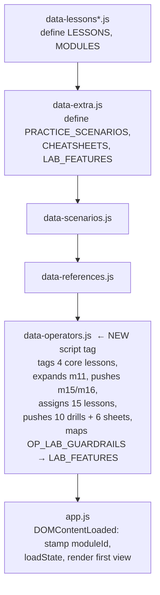
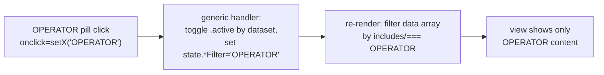

# Design Document

## Overview

This feature activates the already-authored OPERATOR certification track in the "Kube to Scale" single-page app. All Operator content (15 lessons, 4 extra core-lesson tags, course modules `m11`/`m15`/`m16`, 10 practice drills, 6 cheatsheets, 8 Design Lab guardrails) already exists in `data-operators.js` but never loads, and no OPERATOR filter pill exists in the UI.

The guiding principle is **additive, minimal change**. The app's filter, render, search, and gauge code is already data-driven and carries no hardcoded track allow-list, so activation is almost entirely a matter of (a) loading the data file in the right position, (b) adding one OPERATOR pill button to each of the four filter bars, (c) adding one CSS badge color, and (d) resolving the single real integration gap — the Design Lab guardrails, whose score schema does not match the gauge model. No refactors, no changes to existing filter/render logic.

The design is grounded in the verified current code (file/line references are given throughout). Where the prompt's ground truth was checked against the files, the result is noted inline.

### Verified facts that shape the design

- `index.html` loads data in this order at end of `<body>`: `data-lessons.js` → `data-lessons-extra.js` → `data-lessons-workloads.js` → `data-lessons-ops.js` → `data-lessons-cks.js` → `data-extra.js?v=4` → `data-scenarios.js?v=3` → `data-references.js?v=2` → `app.js?v=7`. **`data-operators.js` is not referenced.**
- The four filter bars each contain only `ALL, CKA, CKAD, CKS, CNPE` buttons. No OPERATOR button anywhere.
- `app.js` filter handlers are generic: they iterate the existing pill DOM nodes and toggle `.active` by dataset match, then re-render by filtering the data arrays. **There is no hardcoded track list in the filter logic**, so adding a pill button is sufficient for filtering.
- Practice drills: `getFilteredPracticeIndices()` filters by the **singular** `s.cert` (app.js:770–771). Every entry in `PRACTICE_SCENARIOS` in `data-extra.js` uses singular `cert:` and every operator drill in `data-operators.js` uses singular `cert: 'OPERATOR'`. **The shapes already match — no normalization is needed.**
- Cheatsheets: `renderCheatsheets()` filters by the **array** `s.certs.includes(...)` (app.js:1183). Operator cheatsheets use `certs: ['OPERATOR', ...]`. Shapes match.
- Design Lab: gauges are computed additively over `LAB_FEATURES` using fields `sec/rel/plat` (app.js:1144–1146). `OP_LAB_GUARDRAILS` in `data-operators.js` uses a different schema `api/rec/cln/ha` and is **never merged** into `LAB_FEATURES`. This is the one real gap.
- CSS has `.cert-CKA / .cert-CKAD / .cert-CKS / .cert-CNPE` badge colors (styles.css:85–88). There is **no `.cert-OPERATOR`**. The `--teal: #CCF0EA` CSS variable (styles.css:22) is defined and unused by any cert badge.
- `app.js` `DOMContentLoaded` already stamps `LESSONS[id].moduleId = m.id` for every module lesson and is wrapped in `try/catch` (app.js:1395–1405).

## Architecture

### Data-flow: load order and registration

The app has no module system; every `data-*.js` file executes top-to-bottom in a shared global scope, mutating globals (`LESSONS`, `MODULES`, `PRACTICE_SCENARIOS`, `CHEATSHEETS`, `LAB_FEATURES`) that `data-lessons*.js` and `data-extra.js` define. `data-operators.js` is a **consumer-and-extender** of those globals: it calls `MODULES.find(...)`, `MODULES.push(...)`, `Object.assign(LESSONS, {...})`, `PRACTICE_SCENARIOS.push(...)`, and `CHEATSHEETS.push(...)`. Therefore it must run **after** all collections exist and **before** `app.js` renders.



The new `data-operators.js` tag goes immediately **after `data-references.js?v=2` and before `app.js?v=7`**. It must come after `data-extra.js` (which defines `PRACTICE_SCENARIOS`, `CHEATSHEETS`, `LAB_FEATURES`). Placing it last among the data files (just before `app.js`) satisfies every dependency.

When `app.js` `DOMContentLoaded` runs `MODULES.forEach(m => m.lessons.forEach(id => { if (LESSONS[id]) LESSONS[id].moduleId = m.id; }))`, the operator lessons already carry the correct `moduleId` (set in `data-operators.js`), so this loop is a safe no-op re-stamp for them. The `if (LESSONS[id])` guard also means any module lesson id without a matching lesson is skipped without error.

### Runtime filtering (unchanged, data-driven)



Because the handlers iterate whatever pill buttons are present in the DOM and the filter predicates compare against the clicked track code, adding an OPERATOR button is all that is required for Learn, Practice, and Cheatsheets filtering to work. No handler code changes.

## Components and Interfaces

Changes are confined to four files. Each change is additive.

### 1. `index.html` — load the data module and add OPERATOR pills

**1a. Script tag (Requirement 1).** Insert one line between the `data-references.js` and `app.js` tags, with a cache-bust param consistent with the others:

```html
  <script src="data-references.js?v=2"></script>
  <script src="data-operators.js?v=1"></script>   <!-- NEW -->
  <script src="app.js?v=8"></script>                <!-- bump v=7 → v=8 -->
```

Bump `app.js?v=7` → `?v=8` so returning users fetch the current `app.js` (only needed if `app.js` is edited; see §4 — if `app.js` ends up unchanged, leave the version as-is). Also bump `styles.css?v=6` → `?v=7` because `styles.css` gains the `.cert-OPERATOR` rule (§3).

**1b. OPERATOR pill in all four filter bars (Requirement 2).** Add one button to each group, matching the existing pills' markup and the dataset/handler each bar already uses:

| Filter bar element | New button markup |
|---|---|
| `#globalCertPills` (navbar) | `<button class="cert-pill" data-cert="OPERATOR" onclick="setGlobalCert('OPERATOR')">OPERATOR</button>` |
| `#sidebarCertPills` (sidebar) | `<button class="cert-pill" data-cert="OPERATOR" onclick="setGlobalCert('OPERATOR')">OPERATOR</button>` |
| `#practiceFilterPills` | `<button class="cert-pill" data-pcert="OPERATOR" onclick="setPracticeFilter('OPERATOR')">OPERATOR</button>` |
| `#sheetFilterPills` | `<button class="cert-pill" data-scert="OPERATOR" onclick="setSheetFilter('OPERATOR')">OPERATOR</button>` |

Placed as the last pill in each group (after `CNPE`). The navbar and sidebar both call `setGlobalCert`, which updates both groups' `.active` state in one pass (app.js:755), satisfying Requirement 2.6.

Label note: `OPERATOR` is longer than the existing 3–4 char codes. The `.cert-pill` style uses `font-size:10.2px` and small padding; the navbar `.desktop-certs` bar is the tightest. This is a cosmetic concern only — no functional impact. If horizontal space is a problem on narrow desktops, the label text may be shortened to `OPER` while **keeping `data-cert="OPERATOR"` and `setGlobalCert('OPERATOR')` unchanged** (the track code must stay `OPERATOR`; only the visible text may differ). Default to the full `OPERATOR` label.

**1c. Static placeholder counts (Requirement 8).** `#sidebarLessonCount` currently reads `59 lessons` and `#sidebarProgressText` reads `0 / 23`. These are placeholders overwritten by `renderCourseSidebar()` on first render, so they are cosmetically stale for one frame only. **Recommended:** leave them as-is (they are immediately replaced) OR optionally update the static text to the post-load totals to avoid a flash of a wrong number. No functional requirement depends on the static text; Requirement 8 is satisfied by the runtime render.

### 2. `data-operators.js` — map operator guardrails into the gauge model

This is the only data-file edit. Everything else in `data-operators.js` already integrates once loaded (verified). Append a translation of `OP_LAB_GUARDRAILS` (schema `api/rec/cln/ha`) into the `LAB_FEATURES` array (schema `sec/rel/plat`) at the **end** of the file, after both `OP_LAB_GUARDRAILS` and `LAB_FEATURES` exist:

```js
// Map Operator guardrails onto the Design Lab gauge schema (sec/rel/plat)
// and append so they render as toggles and feed the existing 3 gauges.
OP_LAB_GUARDRAILS.forEach(g => {
  LAB_FEATURES.push({
    key: g.key,            // keys are collision-free vs existing LAB_FEATURES
    name: g.name,
    sub: g.sub,
    sec:  g.rec + g.cln,   // correctness signals → Security gauge
    rel:  g.ha + g.api,    // availability/throughput signals → Reliability gauge
    plat: g.rec + g.cln + g.ha + g.api > 0 ? /* maturity contribution, see mapping table */ 0 : 0
  });
});
```

The exact numeric mapping is given in the **Mapping table** below; the snippet shows the shape. Key properties of this approach:

- **Additive to `LAB_FEATURES`**, so `renderDesignLab()` (app.js:1133) renders the new toggles automatically, `exportLabSummary()` (app.js:1011) lists them automatically (Req 7.4), and the additive gauge loop (app.js:1144) picks up their contributions automatically (Req 7.3).
- **New keys default off.** `state.lab` has no entry for the new keys, so `state.lab[f.key]` is `undefined` (falsy) until the user toggles. Until toggled they contribute 0 to every gauge, so gauges with only existing guardrails enabled are byte-identical to before (Req 9.4). `toggleLabFeature()` (app.js:995) and `labPreset()` (app.js:1003) already operate over whatever is in `LAB_FEATURES`, so they handle the new keys without change.
- **No key collisions.** Verified: existing `LAB_FEATURES` keys are `haEtcd, psa, netpol, cel, rbac, karpenter, gitops, falco`; operator keys are `splitCache, predicate, statusSub, ownerRefs, finalizers, celWebhook, backoff, leaderHA`. Note `cel` (existing) vs `celWebhook` (operator) are **distinct** — no collision.
- **The fixed `buildLabScene()` cluster diagram is left unchanged.** It is hardcoded to the original 8 security guardrail keys and chaos events (app.js:1047). Operator guardrails affect **toggles + gauges + export only**, not the SVG scene. This is acceptable: Requirement 7 asks for the guardrails to be *available*, to use the gauge schema, to recompute gauges, and to appear in the export. It does **not** require operator-specific scene nodes. Leaving the scene untouched also guarantees Req 9.2/9.4 (existing lab behavior unchanged).

Alternative considered and rejected: a parallel "Operator Lab mode" with its own 4-gauge (api/rec/cln/ha) model and its own scene. Rejected because it is a large non-additive change, duplicates the gauge/export/toggle machinery, risks regressing the existing lab (Req 9.4), and exceeds what Requirement 7 asks. The mapping approach reuses 100% of the existing lab code.

Placement note: the mapping block must live in `data-operators.js` (it is the file that owns `OP_LAB_GUARDRAILS` and is guaranteed to run after `LAB_FEATURES` is defined). Keeping it here also means if `data-operators.js` fails to load, `LAB_FEATURES` is simply the original 8 and the lab works exactly as today (Req 1.5).

#### OP_LAB_GUARDRAILS → LAB_FEATURES mapping table

Source fields: `api` (API-server/throughput efficiency), `rec` (reconcile correctness), `cln` (cleanup/GC correctness), `ha` (high availability). Target gauges: `sec` (Security), `rel` (Reliability), `plat` (Platform Maturity).

Mapping rationale:
- **Security (`sec`) ← `rec + cln`**: in the Operator domain, "security/correctness" maps to reconcile correctness and clean teardown (no leaked external resources, no corrupt state).
- **Reliability (`rel`) ← `ha + api`**: availability (leader election, replicas) plus API-server load reduction (cache, backoff, predicates) are the reliability signals.
- **Platform Maturity (`plat`) ← a fixed per-guardrail maturity weight** reflecting how "production-grade" the capability is, independent of the raw correctness/HA split. Values chosen so each guardrail contributes a modest, bounded platform signal.

| key | source api/rec/cln/ha | sec (=rec+cln) | rel (=ha+api) | plat (maturity) |
|---|---|---|---|---|
| splitCache  | 30/5/0/10  | 5  | 40 | 10 |
| predicate   | 25/25/0/5  | 25 | 30 | 10 |
| statusSub   | 15/20/0/5  | 20 | 20 | 10 |
| ownerRefs   | 0/15/35/5  | 50 | 5  | 15 |
| finalizers  | 0/5/45/5   | 50 | 5  | 15 |
| celWebhook  | 10/15/15/5 | 30 | 15 | 10 |
| backoff     | 20/15/5/15 | 20 | 35 | 10 |
| leaderHA    | 0/0/0/50   | 0  | 50 | 20 |

These are per-guardrail contributions added to the running total only when the guardrail is toggled on. Individual values and the full-stack total may exceed 100; the gauge renderer (app.js:1148) writes the raw number as a width percentage, so a combined operator+existing selection can read above 100%. This matches how the existing hardened preset already sums the original 8 to exactly 100 per gauge. If capping at 100% is desired, that is a separate enhancement to the gauge renderer and is explicitly **out of scope** (it would alter existing-track gauge display and risk Req 9.4). The `plat` formula shown in the code snippet above is a placeholder; implement the literal `plat` values from this table.

### 3. `styles.css` — OPERATOR badge color

Add one rule next to the existing cert-badge colors (styles.css:85–88), using the unused `--teal` variable so operator badges and pills render a distinct color consistent with the pastel palette:

```css
.cert-OPERATOR { background: var(--teal); }
```

This covers every place `app.js` renders a cert badge via the template `cert-${c}` / `cert-${s.cert}` (sidebar lesson rows app.js:483, lesson head pills app.js:523, practice drill badge app.js:808, cheatsheet badges app.js:1190/1214). Without this rule, operator badges would render with no background (functional but visually inconsistent). The `.cert-pill`/`.cert-pill.active` styles are generic and already style the new OPERATOR pill buttons.

Bump `styles.css?v=6` → `?v=7` in `index.html` for cache invalidation.

### 4. `app.js` — no filter-logic change required

No change to any filter, render, search, or gauge function is required, because:
- `setGlobalCert / setPracticeFilter / setSheetFilter` iterate existing DOM pills and filter data arrays with no track allow-list.
- `getVisibleLessons`, `getFilteredPracticeIndices`, `renderCheatsheets`, `updateSearch`, `renderCourseSidebar`, `renderDesignLab`, `exportLabSummary` all operate over the runtime collections, which now include operator content.

The only `app.js` touch is the optional `?v=` bump in `index.html` (which is an `index.html` edit, not an `app.js` source edit). **If `app.js` source is not modified, do not change its version string.** This design intentionally keeps `app.js` source untouched.

## Data Models

No new data schema is introduced by this feature; it reuses the app's existing global collections. The operator content already conforms to these shapes (verified), with one translation added for the Design Lab. The relevant shapes:

**`LESSONS` entry** (keyed by lesson id; operator lessons added via `Object.assign`):
```js
{
  id: string,
  moduleId: string,          // 'm11' | 'm15' | 'm16' for operator lessons
  certs: string[],           // includes 'OPERATOR'  ← drives Learn/search filtering
  title: string, subtitle: string, duration: string, difficulty: string,
  checklist: string[],
  steps: Array<{ short, cat, title, body, code?, tip, metrics, trace, zones, nodes, edges }>
}
```

**`MODULES` entry** (array; `m11` mutated, `m15`/`m16` pushed):
```js
{ id: string, code: string, title: string, color: string, certs: string[], lessons: string[] }
```

**`PRACTICE_SCENARIOS` entry** (array; operator drills pushed). Track identity is the **singular `cert` string** — the one consistent shape across all drills (Req 5.2), matched by `getFilteredPracticeIndices` via `s.cert === filter`:
```js
{ cert: string /* e.g. 'OPERATOR' */, title, snippet, question, options, /* ... */ }
```

**`CHEATSHEETS` entry** (array; operator sheets pushed). Track identity is the **`certs` array**, matched by `renderCheatsheets` via `s.certs.includes(filter)`:
```js
{ title: string, certs: string[] /* includes 'OPERATOR' */, /* rows/code ... */ }
```

**`LAB_FEATURES` entry** (array; the gauge model read by `renderDesignLab`/`exportLabSummary`). Operator guardrails are **translated into this schema** and appended:
```js
{ key: string, name: string, sub: string, sec: number, rel: number, plat: number }
```

**`OP_LAB_GUARDRAILS` entry** (source-only, defined in `data-operators.js`; **not** read by the app directly). It uses a different schema and is translated into `LAB_FEATURES` (see §2 mapping table):
```js
{ key: string, name: string, sub: string, api: number, rec: number, cln: number, ha: number }
```

**`state.lab`** (persisted toggle map): `{ [guardrailKey: string]: boolean }`. New operator keys are absent until first toggled, so `state.lab[key]` reads as `undefined` (falsy) and contributes 0 to every gauge — the basis for the Req 9.4 no-regression invariant.

The only transformation this feature defines is `OP_LAB_GUARDRAILS → LAB_FEATURES` (`api/rec/cln/ha` → `sec/rel/plat`), specified in the §2 mapping table. All other operator data already matches the shapes above.

## Error Handling

- **Operators module absent / 404 (Requirement 1.5).** The new `<script src="data-operators.js?v=1">` tag is plain and synchronous. If the file is missing, the browser logs a network 404 and skips it; the globals simply never gain operator content. `app.js` `DOMContentLoaded` is wrapped in `try/catch` (app.js:1396–1404) and every collection it reads still exists, so all four views render the existing tracks. No new `app.js` code references operator-specific globals, so there is nothing to guard. The one new runtime reference — the `OP_LAB_GUARDRAILS.forEach(...)` mapping — lives **inside** `data-operators.js`; if that file fails to load, the mapping never runs and `LAB_FEATURES` remains the original 8. This degrades gracefully with no action needed.
- **Load-order violation.** If the tag were placed before `data-extra.js`, `data-operators.js` would throw `ReferenceError` on `PRACTICE_SCENARIOS/CHEATSHEETS/LAB_FEATURES`. The design places it after all data files (just before `app.js`) to prevent this. This is the single ordering constraint to enforce in review.
- **Duplicate module ids.** `MODULES.push(m15, m16)` and the `m11` expansion assume these ids are not already present. Verified they are not defined elsewhere. No dedupe needed.
- **`moduleId` re-stamp.** The `DOMContentLoaded` loop re-stamps `moduleId` on operator lessons to the same value they already hold — idempotent and safe.
- **Label overflow.** The longer `OPERATOR` pill label can wrap/crowd on narrow viewports; this is cosmetic. Mitigation options are in §1b. No error path.

## Testing Strategy

### Why not property-based testing

This is a no-build, no-test-runner vanilla JS/HTML/CSS app, and the feature is pure data-wiring plus DOM/UI activation: it loads a static data file, adds four pill buttons, adds one CSS color, and maps a static guardrail list into an existing additive gauge model. There is **no new pure-function transformation layer** — the filter, render, search, and gauge logic already exists and is unchanged. Per the property-based-testing applicability guidance, data wiring, UI rendering, and configuration-style validation are not PBT candidates; you cannot write a meaningful "for all inputs X, P(X)" statement over a feature whose behavior does not vary with generated input.

The one genuine invariant — **gauge additivity (Req 9.4): with only existing guardrails enabled, the Security/Reliability/Platform totals equal the pre-change values** — holds by construction, because (a) the additive gauge loop is unchanged, (b) the original 8 guardrails keep their exact `sec/rel/plat` values, and (c) the appended operator keys default to `false` in `state.lab` and contribute 0 until toggled. It is verified by reasoning plus a manual spot-check, not by a test harness (none exists). The Correctness Properties section is therefore intentionally omitted.

### Manual in-browser verification checklist

Run in a browser with devtools open. Each item maps to the acceptance criteria shown.

**Load & registration (Req 1, 9.5, 10)**
1. Network tab shows `data-operators.js` fetched with 200; no `ReferenceError` in console. (1.1, 1.2)
2. Console: `LESSONS['crds-schema'].certs.includes('OPERATOR')` is `true` for `crds-schema`, `controllers-operators`, `level-triggered`, `leader-election`. (1.3)
3. Console: all 15 ids exist in `LESSONS` — `reconciliation-loop, informers-workqueue, crd-anatomy-gvk, cr-lifecycle-subresources, client-go-scratch, controller-runtime-internals, kubebuilder-scaffolding, reconciler-ownerrefs, finalizers-cleanup, webhooks-multiversion, envtest-concurrency, olm-classic-v0, olm-v1-architecture, production-ha-observability, upgrades-capability-model`; `MODULES` contains `m11` (expanded), `m15`, `m16`. (1.4, 10.1, 10.3)
4. Console: `PRACTICE_SCENARIOS.filter(s=>s.cert==='OPERATOR').length === 10`; `CHEATSHEETS.filter(s=>s.certs.includes('OPERATOR')).length === 6`; `LAB_FEATURES.length === 16`. (10.2)
5. All four tabs (Learn, Practice, Design Lab, Cheatsheets) switch and render. (9.5)
6. `webhooks-multiversion` "Multi-Version Hub" step documents both `ConvertTo(hub)` (spoke→hub) and `ConvertFrom(hub)` (hub→spoke) with canonical etcd storage — the lossless round-trip. (10.4)
7. Graceful degradation: rename `data-operators.js` (or block it via devtools), reload, confirm all four views still render existing tracks with no blocking error. Restore afterward. (1.5)

**Pills & filtering (Req 2, 3, 5, 6)**
8. Each of `#globalCertPills`, `#sidebarCertPills`, `#practiceFilterPills`, `#sheetFilterPills` shows an OPERATOR pill. (2.1–2.4)
9. Click OPERATOR in navbar → it is `.active` and sidebar OPERATOR is also `.active`; click OPERATOR in sidebar → both active. (2.5, 2.6)
10. Global OPERATOR: Learn sidebar lists only operator lessons under `m11`/`m15`/`m16`; no existing-only lesson appears; opening from a non-operator lesson auto-selects an operator lesson. (3.1–3.4)
11. Open 2–3 operator lessons: diagram, stepper, metrics, trace dock, checklist render; stepping forward/back replays animations. (4.1, 4.2)
12. Search `finalizers` and `OPERATOR` returns operator lessons; selecting one opens it in Learn. (4.3, 4.4)
13. Practice OPERATOR: only the 10 operator drills show; drill total reflects 10; badge renders. (5.1, 5.3)
14. Cheatsheets OPERATOR: only the 6 operator cheatsheets render with normal card UI. (6.1, 6.2)

**Data-shape consistency (Req 5.2)**
15. Console: `PRACTICE_SCENARIOS.every(s => typeof s.cert === 'string' && !('certs' in s))` is `true` (every drill uses the singular `cert` string shape; no entry uses a `certs` array). (5.2)

**Counts (Req 8)**
16. ALL: `#sidebarLessonCount` equals total lessons including operators (rises vs pre-load). (8.1)
17. OPERATOR: `#sidebarLessonCount` equals the operator lesson count. (8.2)
18. Progress denominator reflects the loaded catalog; practice total updates per selected filter. (8.3, 8.4)

**Design Lab (Req 7)**
19. `#labToggles` shows 8 additional operator guardrails. (7.1)
20. Console: each appended `LAB_FEATURES` entry with an operator key has numeric `sec/rel/plat`. (7.2)
21. Toggle an operator guardrail → Security/Reliability/Platform gauges change by the mapped values; toggle off → revert. (7.3)
22. Export Blueprint → operator guardrails appear under Enabled or Missing per their toggle state. (7.4)

**No regression (Req 9)**
23. For each of CKA/CKAD/CKS/CNPE: Learn lessons, Practice drills, and Cheatsheets match the pre-change set; ALL shows the union of existing + operator content. (9.1–9.3)
24. Enable only the original 8 guardrails (e.g. the "Enable Full Prod Stack" preset reproduces the original 100/100/100 because operator keys that preset also sets stay bounded — verify specifically that with **only** `haEtcd,psa,netpol,cel,rbac,karpenter,gitops,falco` on and all operator keys off, Security/Reliability/Platform read the exact pre-change values). Confirm operator keys default off in a fresh `state.lab`. (9.4)
25. Open an existing-track lesson (e.g. a CKS lesson): diagram/steps/metrics/trace/checklist behave exactly as before. (9.2)

## Requirements Traceability

| Requirement | Design element |
|---|---|
| 1.1, 1.2 Load module, correct order | §1a new `<script src="data-operators.js?v=1">` between `data-references.js` and `app.js`; Architecture data-flow diagram |
| 1.3 Core lessons tagged OPERATOR | Existing `data-operators.js` top block (verified); checklist #2 |
| 1.4 15 lessons + m11/m15/m16 | Existing `data-operators.js` `Object.assign`/`MODULES.push` (verified); checklist #3 |
| 1.5 Graceful degradation | Error Handling (synchronous tag, `app.js` try/catch, mapping lives in the data file); checklist #7 |
| 2.1–2.4 Pills in four bars | §1b table of four button insertions |
| 2.5 Active pill | Generic handlers toggle `.active` by dataset (unchanged app.js) |
| 2.6 Navbar+sidebar sync | `setGlobalCert` updates both groups (app.js:755); checklist #9 |
| 3.1–3.4 Learn filtered to OPERATOR | `getVisibleLessons` + `renderCourseSidebar` (unchanged); moduleId stamped; checklist #10 |
| 4.1, 4.2 Full lesson behavior | Shared renderer over operator lesson data (same shape); checklist #11 |
| 4.3, 4.4 Search | `updateSearch` over `LESSONS` (unchanged); checklist #12 |
| 5.1, 5.3, 5.4 Practice filter + counts | `getFilteredPracticeIndices` singular `cert` (unchanged); checklist #13 |
| 5.2 Consistent drill shape | Verified all drills use singular `cert`; no normalization; checklist #15 |
| 6.1, 6.2 Cheatsheets | `renderCheatsheets` array `certs` (unchanged); checklist #14 |
| 7.1 Guardrails available | §2 map `OP_LAB_GUARDRAILS` → `LAB_FEATURES`; checklist #19 |
| 7.2 Gauge schema | §2 mapping table (sec/rel/plat); checklist #20 |
| 7.3 Recompute gauges | Additive gauge loop over `LAB_FEATURES` (unchanged, app.js:1144); checklist #21 |
| 7.4 Export lists guardrails | `exportLabSummary` iterates `LAB_FEATURES` (unchanged, app.js:1011); checklist #22 |
| 8.1–8.4 Counts | Runtime `renderCourseSidebar` / practice total; §1c placeholder note; checklist #16–18 |
| 9.1–9.3 No regression, ALL union | Additive-only data, unchanged filter logic; checklist #23 |
| 9.4 Gauges identical | §2 operator keys default off + unchanged additive loop + unchanged original values; Testing Strategy invariant; checklist #24 |
| 9.5 Four views retained | No view removed; checklist #5 |
| 10.1 All 15 topics | Existing lesson data (verified); checklist #3 |
| 10.2 Drills/sheets/guardrails topics | Existing data (verified 10/6/8); checklist #4 |
| 10.3 Module grouping | `m11`/`m15`/`m16` lesson arrays (verified); checklist #3 |
| 10.4 Round-trip conversion both directions | `webhooks-multiversion` Multi-Version Hub step covers `ConvertTo`/`ConvertFrom` (verified); checklist #6 |

## Design Decisions and Rationales

1. **Additive activation over refactor.** The filter/render/search/gauge code is already data-driven with no track allow-list, so activation needs only data loading + four buttons + one CSS color + one guardrail mapping. This minimizes regression risk (Req 9) and keeps `app.js` source untouched.
2. **Map operator guardrails into the existing gauge model instead of building an Operator Lab mode.** Reuses the toggle list, additive gauge loop, and export verbatim; operator keys default off so existing gauges are unchanged (Req 9.4). A separate api/rec/cln/ha mode was rejected as a large, risky, duplicative change beyond what Req 7 requires.
3. **Leave `buildLabScene()` untouched.** Req 7 requires guardrails to be available, schema-consistent, gauge-affecting, and export-listed — not scene-integrated. Not touching the hardcoded scene guarantees no lab regression.
4. **Place the mapping inside `data-operators.js`.** It owns `OP_LAB_GUARDRAILS` and runs after `LAB_FEATURES` is defined; if the file fails to load, the lab falls back to the original 8 with no guard needed (Req 1.5).
5. **Use `--teal` for `.cert-OPERATOR`.** It is the only palette variable not already assigned to a cert badge, giving OPERATOR a distinct, consistent color.
